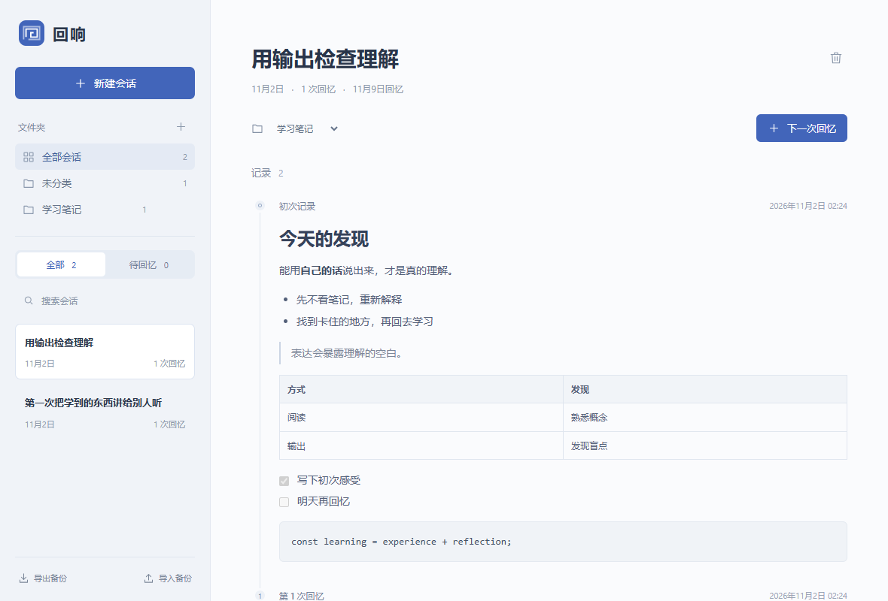

# 回响 · Recall

一个轻量的本地回忆笔记本：经历一件事，写下当时的感受，过一段时间再写一次。

[下载 Windows 版本](https://github.com/Explainfuture/recallWhatYouExperienced/releases/latest) · [查看构建状态](https://github.com/Explainfuture/recallWhatYouExperienced/actions)



## 使用

1. 新建事件，填写事件名称和初次记录，点击保存。
2. 下次打开，选择这个事件，点击“下一次回忆”，写下现在还能想起的内容。
3. 每次回忆都单独保存，保留之前的记录，方便对照理解的变化。

记录支持 Markdown，包括标题、列表、引用、代码块、链接和图片。保存后按格式展示；点击链接会打开系统浏览器或邮件应用。Markdown 原文保存在本地，引用的网络图片需要联网加载。

可以创建文件夹整理事件，也可以随时移动事件。删除文件夹会把其中的事件移到“未分类”，保留记录。

首次保存后，次日开始显示待回忆提示；每次回忆后，下一次提示安排在七天后。日期按设备所在时区的自然日计算，从当天零点起到期。你也可以随时提前回忆。提示只显示在应用内，不发送系统通知。

## 数据

- 事件、回忆和文件夹保存在当前设备的 IndexedDB 中，不需要账号、服务器或联网同步。升级应用后会自动兼容旧版数据，旧记录归入“未分类”。
- 写到一半的内容会暂存在本机 localStorage，重开或切换事件后可继续写；点击保存后才成为正式记录。备份只包含正式保存的记录。
- 可以导出 JSON 备份，并在另一份应用中导入。备份包含文件夹；导入按编号合并，不清空已有数据，发现冲突时取消整个导入。新版也可以导入 0.1.0 的备份。
- 浏览器预览、开发版和安装版可能使用不同的存储空间，迁移时请导出再导入。
- 清除浏览器或应用数据会影响本地记录，请按需保留备份。公开仓库只包含程序源代码，不包含你的笔记。

## 开发

技术栈：Tauri 2、React、TypeScript、Vite、react-markdown。数据层直接使用 IndexedDB，无数据库服务。

安装 Node.js 22 后运行：

```sh
npm ci
npm run dev
```

打开终端显示的本地地址，即可在浏览器中体验。

```sh
npm test        # 数据保存、文件夹、回忆计划和备份合并测试
npm run build  # 类型检查和前端生产构建
```

## 桌面应用

Windows 本地编译需要 Rust、Microsoft C++ Build Tools 和 WebView2。安装步骤见 [Tauri 官方环境准备文档](https://v2.tauri.app/start/prerequisites/)。

```sh
npm run tauri -- dev
npm run tauri -- build --bundles nsis
```

安装包输出到 `src-tauri/target/release/bundle/nsis/`。更多打包选项见 [Tauri Windows 安装包文档](https://v2.tauri.app/distribute/windows-installer/)。

仓库配置了 [GitHub Actions](https://github.com/Explainfuture/recallWhatYouExperienced/actions)：推送到 `main` 后先运行测试和前端构建，再编译 Windows x64 安装包。成功的工作流会提供 `Recall-Windows-x64` 构建产物；下载解压后运行其中的安装程序。也可以在 Actions 页面手动触发构建。

## 许可

[MIT](LICENSE)
